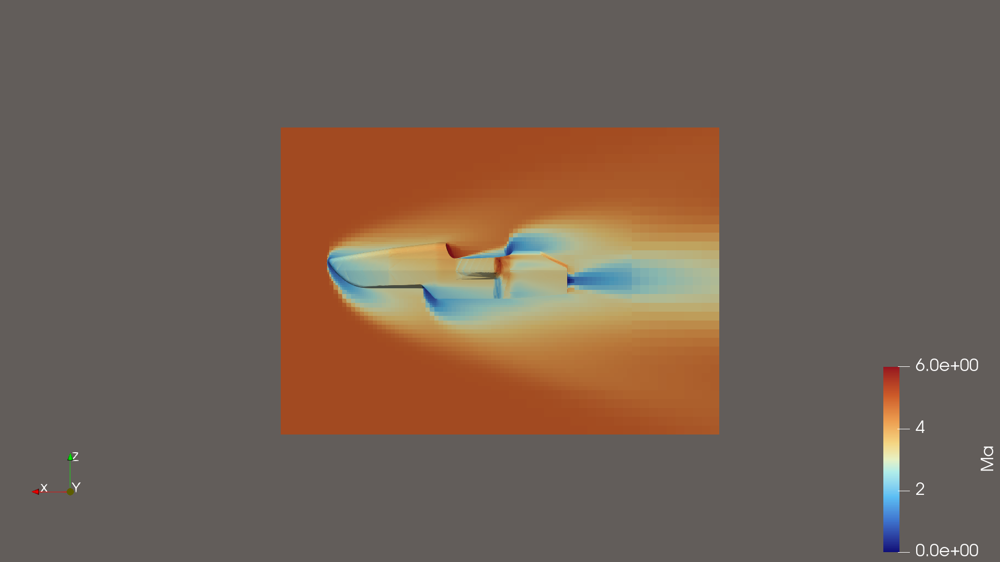
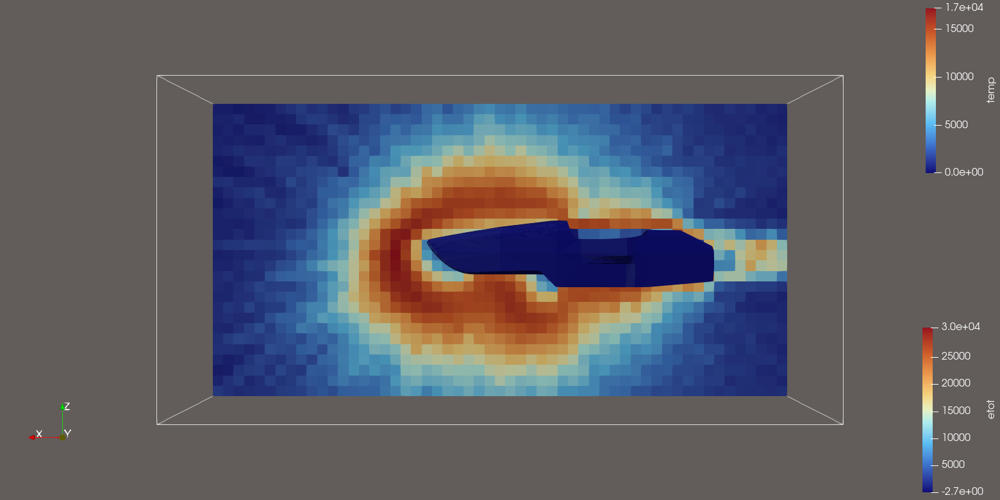
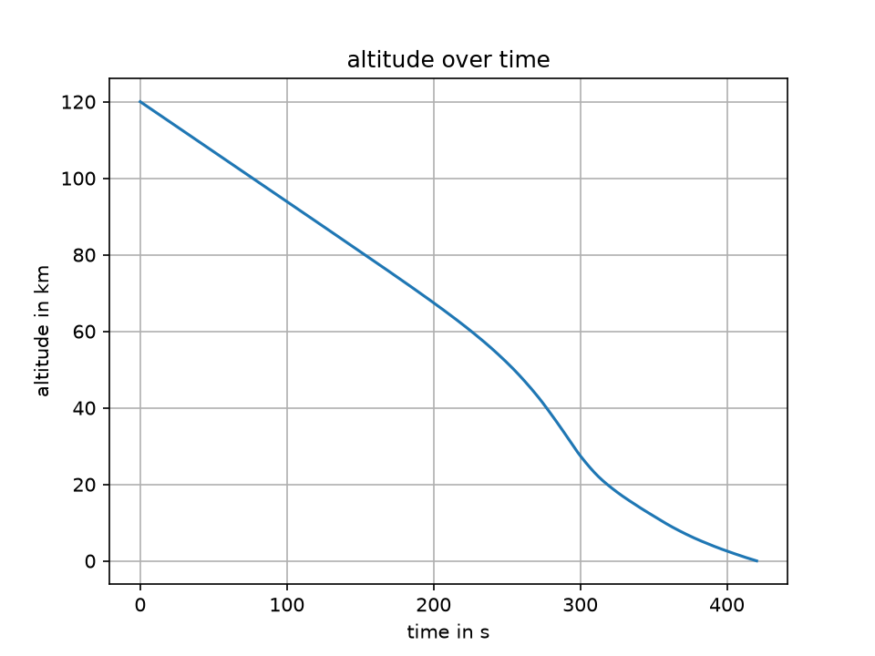
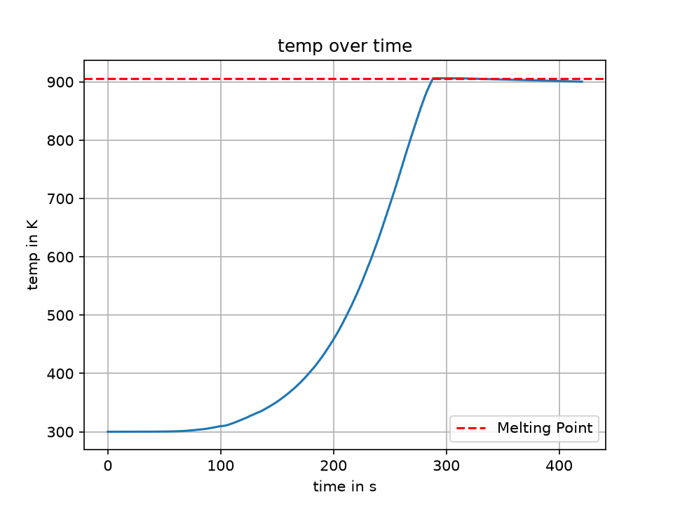

# A Monocoque re-entering Earth's Atmosphere
# A Test Run of CFD in OpenFOAM, DSMC with SPARTA and TITAN on a Formula Student Monocoque

This is a simulation series to learn and understand different forms of fluid simulation methods.
The study shows what happens to a monocoque on re-entry, where the limits of CFD are, where DSMC starts and how TITAN works with the combination of CFD and DSMC.
The timeframe to conduct this project was 5 days, starting on Monday the 12th.

## Overview:

1. Basics of OpenFOAM
2. Simulating the Monocoque with OpenFOAM
3. Simulating the Monocoque with SPARTA
4. Simulating the trajectory with TITAN

## 1 Basics of OpenFOAM
To understand the basics of OpenFOAM, the test example wedge15 was simulated. The goal was to compare the theoretical shock angle of an oblique shock to the simulated one.
In ParaView the angle was calculated to be 24.6 degrees. With the θ-β-M theory 24.3 degrees was calculated. That is just a 1% difference.

## 2 Simulating the Monocoque with OpenFOAM at Mach 5 at 40 km altitude
Then the monocoque was simulated in OpenFOAM. To simulate with a hypersonic free stream velocity, the ICAO standard atmosphere values were used.
To mesh, the combination of blockMesh and snappyHexMesh was used to make a simple mesh of the bounding box and the monocoque. This was a half-car simulation to reduce the computational power. Overall it had 144k cells.
After the first unsuccessful simulation attempt, the driver had to be removed from the monocoque.
As a solver rhoCentralFoam was used. It had to be a first order simulation because of stability issues.
Convergence was proven by plotting max p and min T in Python.
It was verified with the Rayleigh–Pitot formula for the stagnation pressure behind a normal shock, which calculated a pressure of 9060 Pa at the nose. Measured with ParaView in my simulation there was a pressure of 9344 Pa, which comes up to a difference of 3%.
Also the max temperature of 1688 K was compared to its theoretical max, the total temperature T₀ = 1506 K calculated with energy conservation. There a difference of 12% was found. That is a bit too large. My theory is that it is because of the coarse mesh at the nose. There are only 3 cells between the shock and the nose.

## 3 Simulating the Monocoque with SPARTA at Mach 20 at 120 km altitude
Here the values of the US Standard Atmosphere were used to simulate the environment.
The Knudsen number of 1.2 was calculated. That means we are in the transitional regime. This means the Navier–Stokes equations are no longer valid and DSMC is the best method here.
The gas that high in the atmosphere is N₂/O₂/O = 0.73/0.09/0.18.
For the mesh, DSMC theory requires a dx smaller than λ/3, which in my case is 1.07 meters. That is too big to accurately resolve the monocoque. Therefore dx = 0.1 m was chosen.
That meant there are 46200 cells. The time step had to be 4.44 µs.
For 20 particles in each cell, Fnum had to be 2.55·10¹³.
The simulation was then steady after 1000 steps. It was averaged over the last 1000 of the 2000 steps. Overall 100 samples were used.
To verify the number of particles used, you can calculate that an empty box would have n · V / F_num = 926 000 particles. SPARTA used 914 613, a bit less because the monocoque can't have particles inside of it. The missing ~11 400 particles correspond to 11 400 · F_num / n = 0.57 m³, which is exactly the volume of the monocoque. That means the geometry and density are correct.
The theoretical collision rate is c̄ · Δt / (2λ) ≈ 3.5·10⁻⁴. SPARTA calculated 4.3·10⁻⁴. Those numbers are in the same ballpark. That means all the inputs are coherent with what SPARTA calculated.
To view it in ParaView, I have written a Python script with the help of AI to convert the text dump from SPARTA into VTK for ParaView.
In the picture you can see a thicker, hotter region around the car and not a thin shock like in the OpenFOAM 40 km version.

## 4 Simulating the re-entry trajectory with TITAN
The start was at 120 km and 7500 m/s with an angle of -2 degrees. The material used for the monocoque was the TITAN test material 'Unittest', which is similar to aluminium but with a density of 1000 kg/m³.
The result was the following: It reached the ground after about 420 s. The melting temperature was reached after 290 s.
The mass changed from 549.9 to 498.9 kg. That means that 9% of the mass melted. That means that a real monocoque out of carbon fibre with way less mass and worse thermal capabilities would most likely not survive these thermal loads, because the resin itself would decompose at around 300 to 400 °C.

 

## Limitations
For OpenFOAM, the Euler equations were used, where there is no friction and no thermal transfer.
Because of one bad cell, a 1st order upwind scheme had to be used.
Also the low resolution mesh at the nose resulted in a difference to the predicted calculated values.
There are no chemical reactions calculated in both OpenFOAM and SPARTA, that is why T in the shock region is too large.
In TITAN the monocoque was simulated using a solid block of aluminium, not a carbon fibre hollow monocoque.
In TITAN a 0D thermal model was used, which means there is only one temperature in the whole body.
Also no cases were compared to an experimental validation.

## Next Steps
Make the mesh around the nose finer to get a clearer bow shock and add friction and thermal transfer.
Also one can do TITAN CFD and DSMC coupling.

## The Repository
Here you can find the three simulation setups for OpenFOAM, SPARTA and TITAN:
- `openfoam/` – wedge15Ma5 and racecar_40km, plus `log_auswerten.py`
- `sparta/` – racecar_120km input file, species data and `sparta2vtk.py`
- `titan/` – `Rennwagen.txt` (TITAN configuration), result data and `titan_auswerten.py`
- `images/` – all pictures used in this README

Software: OpenFOAM v2012 (ESI), SPARTA (GitHub version, built with make mpi), TITAN (strath-ace, Python 3.10), ParaView 6.2.

The geometry was left out on purpose as it is property of the Bremergy e.V. Formula Student Team.
